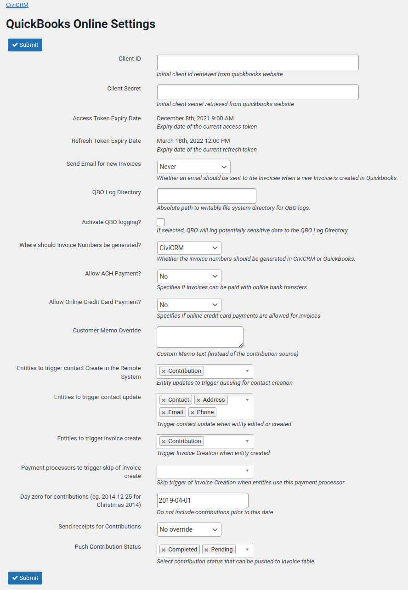

# Configuration

## Create an Intuit app and get your keys

To use this extension, you need to generate a QuickBooks Online consumer key and secret. These come
from an Intuit app that belongs to **your own organisation**. Do not borrow another organisation's app,
including your developer's own test app: usage limits on connections apply per app, so a shared app
would be limited and could incur charges, whereas an app of your own keeps you independent.

Setting up the app takes several steps on the Intuit Developer site, and the Production keys are
locked until you have completed two tasks (steps 5 and 6).

1. You will need an Intuit Developer Account, sign up at
   (https://developer.intuit.com/). This account must be added as a user of `Admin` user type to the
   QuickBooks Online company being integrated.
2. Once your developer account is created and linked, Go to the `My Apps`
   section and select `Create new app`. Intuit's developer platform is offered in several tiers:
   choose the **Builder** tier.
3. Use the `Select APIs` button in the `Just start coding` card, then select the
   Accounting API.
4. Open your app's dashboard (**My Hub** > **Dashboard**). It lists **Development Keys** and
   **Production Keys**. The Production keys show a message such as "Complete these tasks in order to
   unlock your production credentials", followed by the two tasks below. Complete them in order.
5. **Fill in the production app details.** Intuit's form changes from time to time, but expect to be
   asked for the following:

    | Field | What to enter |
    |---|---|
    | Whether you are a US-based organisation | Answer for your organisation. |
    | User license agreement URL (and other administrative URLs) | Your organisation's website address. Intuit requires them, but CiviQuickBooks does not use them. |
    | Host domain | The domain name of your CiviCRM site. |
    | Server or static IP address (if asked) | The IP address of the server that hosts your CiviCRM site. Your hosting provider can tell you what it is. |
    | Launch URL, Disconnect URL and Connect/Reconnect URL | All three are the address of the `QuickBooks Online Settings` page on your CiviCRM site (see [Installation](installation.md), step 7). For example, on WordPress: `https://example.org/wp-admin/admin.php?page=CiviCRM&q=civicrm/admin/setting/quickbooks&reset=1`, or on Drupal: `https://example.org/civicrm/admin/setting/quickbooks?reset=1`. |
    | What the app is used for | Invoicing and payments. |
    | Regulated industries that use the app | None of the above. |
    | Countries | The country or countries your organisation operates in. |

6. **Complete Intuit's App assessment questionnaire.** It asks about your organisation, how the app
   uses Intuit data and how it handles security and errors, and takes 20 to 40 minutes. See the
   [App assessment questionnaire](app-assessment-questionnaire.md) page for every question and the
   answers that are accurate for CiviQuickBooks. Until it is complete you can only use the app with
   Development keys and a QuickBooks sandbox company (see
   [Production or Development](#are-you-using-a-quickbooks-online-production-or-development-account)).
7. Back on the app dashboard, the Production keys are now available. Select the `OAuth 2.0 keys`
   and, in the `Production Keys` section, copy the `Client ID` and `Client Secret`.
8. Paste these values into the CiviQuickBooks Online Settings page and submit. Copy each value in
   full, with no extra spaces: a partly copied key is the usual cause of an "Invalid authorization
   code" error when you authorise (see below).
9. Copy the Redirect URI that is shown on the CiviQuickBooks Online Settings page into your Production
   app on the Intuit Developer site: open the app's **Settings**, go to the **Redirect URIs** tab,
   paste it in and save (the Save button is at the top right).

The CiviQuickBooks Online Settings page looks like this:

**Note**: changing the Client ID or Client Secret on this page clears any stored access/refresh
tokens, so you will need to re-authorise (see below) after doing so.

### Authorise CiviQuickBooks access to your QuickBooks Online account.

1. Click the `Authorize` link as shown below the `Access Token Expiry Date`
   field.
2. The QuickBooks Online Authentication page will now be displayed.
3. Follow the instructions and to complete the authentication process.
4. After authentication, you will be redirected back to CiviCRM.
5. Open the `QuickBooks Online Settings` page.
6. To confirm QuickBooks Online authentication a date will be shown in the
   `Access Token Expiry Date` field. If no date is shown then authentication has
   failed. Repeat the process.

If QuickBooks shows an error such as `Invalid authorization code for access`, the Client ID or Client
Secret on the settings page is wrong. Go back to the app's Production keys on the Intuit Developer
site, copy **both** values again, paste them into the settings page, submit, and click `Authorize`
again. Check that you copied the Production keys, not the Development keys, to match the `Environment`
setting.

Once authorised, the extension records which QuickBooks Online company country (AU, US, UK, CA,
etc.) your connected company uses; this is detected automatically from QuickBooks and is not a
setting you configure yourself.

Next, tell CiviCRM which QuickBooks Products/Services and tax codes to use: see
[Mapping financial accounts](financial-account-mapping.md).

## Are you using a QuickBooks Online Production or Development account?

This extension currently assumes that it will be connected to a QuickBooks Online, `Production` account.
If instead, you wish to connect this to a QuickBooks Online `Development` account then open the `QuickBooks Online Settings` page and change the `Environment` option from `Production` to `Development`.
When you have finished testing in the Development account, then change the `Environment` option back to `Production`.

For more details on the QuickBooks Online environments, see:
* https://developer.intuit.com/app/developer/qbo/docs/develop/sandboxes
* https://developer.intuit.com/app/developer/qbo/docs/develop/sdks-and-samples-collections/php/configuration

## Other settings

The `QuickBooks Online Settings` page also provides the following options:

* **Send Email for new Invoices** - whether QuickBooks Online should email the customer when a new
  Invoice is created: `Never`, `Only if the invoice is unpaid` (the default), or `Always`. See the
  warning in the [initial sync](initial-sync.md#initial-sync-step-by-step) before pushing existing Contributions.
  Many organisations choose `Never`, because CiviCRM already sends its own receipt or invoice and a
  second email from QuickBooks Online is not wanted.
* **Where should Invoice Numbers be generated?** - `CiviCRM` (the default; the Invoice's `DocNumber`
  is set from the Contribution ID using the Invoice Prefix below) or `QuickBooks` (QuickBooks Online
  assigns the number automatically).
* **Invoice Prefix** - the `sprintf()` format used to generate the Invoice `DocNumber` when Invoice
  Numbers are generated by CiviCRM, e.g. the default `Civi-%07d` produces `Civi-0001234` for
  Contribution ID 1234, and `INV_%d` produces `INV_1234`. QuickBooks limits an Invoice number to 21
  characters, so keep the prefix short. If your site already issues CiviCRM invoice numbers (by
  default `INV_` followed by the Contribution ID), use the matching format, for example `INV_%d`, so
  that each Invoice has the same number in both systems and numbering carries on from where it is.
  `%d` adds no zero padding, whereas `%07d` pads to seven digits.
* **Allow Online Credit Card Payment** / **Allow ACH Payment** - whether the pushed Invoice permits
  the customer to pay online via credit card / ACH from within QuickBooks Online. The defaults are
  right if your customers pay through CiviCRM, because CiviCRM sends the Payment to QuickBooks.
* **Customer Memo Override** - optional text to use as the Invoice's Customer Memo instead of the
  Contribution's Source. If this is empty, the Contribution's Source is used as the memo, and if the
  Contribution has no Source the Invoice is pushed without a memo.
* **Activate QBO logging?** - enables additional logging of QuickBooks Online API activity, for
  troubleshooting. The log includes each response's `intuit_tid`, which Intuit support can use to
  trace a request.

### Account Sync options on the same page

The settings page also shows the Account Sync options that control what is queued:

* **Entities to trigger contact Create in the Remote System** and **Entities to trigger invoice
  create** - leave both as `Contribution` so that a Contact and its Invoice are queued when a
  Contribution is saved.
* **Entities to trigger contact update** - the Contact, Email, Address and Phone changes that
  re-queue a Contact so its QuickBooks Customer is updated.
* **Payment processors to trigger skip of invoice create** - Contributions paid through these
  payment processors are never queued.
* **Day zero for contributions** - Contributions received before this date are never synced.
* **Queue all contributions since Day zero?** - see [below](#queue-existing-contributions).
* **Send receipts for Contributions** - sets the CiviCRM `Send receipt?` option for all Contributions
  that are synced.
* **Push Contribution Status** - only Contributions with these statuses (by default Completed and
  Pending) are pushed.

A Contribution is also never queued if it is a test, has a zero amount, or is a Pending Contribution
without the Pay Later flag (an incomplete online transaction).

### Queue existing contributions

Account Sync only queues a Contribution when it is saved, so Contributions that existed before you set
up the sync would never be sent to QuickBooks. To queue them, tick **Queue all contributions since Day
zero?** and save the settings page.

* Every Contribution received on or after the Day zero date is queued, along with its Contact, if it
  meets the rules above and is not on the payment processor skip list.
* Contributions and Contacts that are already queued or synced are left alone, so it is safe to run
  more than once.
* The work is done in batches of 25 Contributions, with a progress screen, so a large number of
  Contributions is not a problem. When it finishes you are returned to the settings page with a message
  saying how many Contributions and Contacts were queued.
* The tick box is an action rather than a setting: it is cleared as soon as the work starts.
* Queueing only prepares the records. They are sent to QuickBooks when the Contact Push and Invoice
  Push jobs run (see the [initial sync](initial-sync.md#initial-sync-step-by-step)).
* The Day zero date is not checked for being sensible. The default, `1990-01-01`, would queue every
  Contribution you have ever recorded, so check it first.

You can see the Contributions that are not yet queued at `Contributions` > `Accounts Integration` >
`Non-Queued Contributions`.
