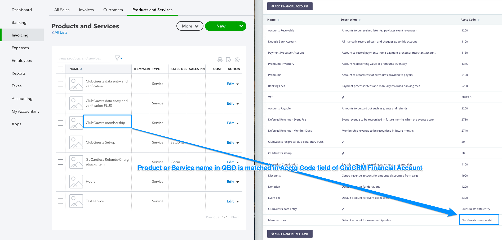

# Mapping financial accounts

QuickBooks needs every Invoice line to have a Product/Service and a tax code. CiviCRM supplies them through the `Acctg Code` of the Financial Accounts attached to each Financial Type. This is the step that most often decides whether an Invoice is pushed, so it is worth getting right before your first sync.

## Map your QuickBooks product/service to CiviCRM Financial account codes

Each QuickBooks Product/Service has a unique name. This is used in the CiviCRM
Financial Account codes to correctly code each Invoice in QuickBooks Online.

1. Open the QuickBooks Company, go to product/service settings page
   ([https://sandbox.qbo.intuit.com/app/items](https://sandbox.qbo.intuit.com/app/items)).
2. Identify each QuickBooks Product/Service that you want to sync with CiviCRM.
3. Open the CiviCRM Financial Account setting page
   (civicrm/admin/financial/financialAccount) and update the `Acctg Code` of
   corresponding Financial account to be the same as each QuickBooks
   Product/Service name:
   
4. When setting up Contributions in CiviCRM, ensure that the Financial Type for
   the Contribution is set to use the correct Financial Account as the Income
   Account.
5. During sync, the Contribution line item will be set to the corresponding
   QuickBooks Product/Service.
6. When a CiviCRM `Acctg Code` does not match any QuickBooks Product/Service
   name, which means that no product/service in QuickBooks has the
   same name, that particular line item will **NOT** be pushed through the
   invoice.

The match is exact: it is case sensitive and punctuation such as brackets counts, so the Product/Service
`Member Dues (4400)` needs the Acctg Code `Member Dues (4400)`. Either the Product/Service Name or its
full `Parent:Child` name (for sub-items) can be used. The list of Products/Services is cached for up to 7
days, so a Product/Service you have just added or renamed in QuickBooks may not be noticed straight
away. Clearing the CiviCRM caches may refresh it sooner.

## Map your QuickBooks tax code to the Sales Tax Account's Acctg Code

When the extension pushes an invoice to QuickBooks Online, it requires every
item to have a specified Tax account.

### For AU Companies:

1. Go to `GST` > `Rates&Settings`. There are many tax accounts listed there,
   with names in column `Tax name`, copy the tax name you want and paste it into
   the `Acctg code` field of corresponding Tax financial account.
2. Open the CiviCRM Financial Account setting page
   (civicrm/admin/financial/financialAccount) and update the `Acctg Code` of
   corresponding Financial account to be the same as each QuickBooks tax account
   name.
3. If a financial type does not contain any GST, a financial account also needs
   to be created with the corresponding Tax account name in QuickBooks filled
   out. For example, create a new financial account called `NO GST` with GST
   rate as `0`, `acctg code`as `GST free` (a tax account name which has GST rate
   as `0` also). And assign that financial account as corresponding line item`s
   `Sales Tax account`.
4. When setting up Contributions in CiviCRM, ensure that the Financial Type for
   the Contribution/line item is set to use the correct Financial Account as the
   `Sales Tax Account`.
5. During sync, the Contribution line item will be assigned with corresponding
   Tax account.
6. When a CiviCRM `Acctg Code` does not match any QuickBooks Tax account name,
   which means that the there is no tax account in QuickBooks has the same name,
   that particular line item will **NOT** be pushed through the invoice.

### For US Companies:

If none of your Contributions are taxable, you can skip this section entirely -
whenever a financial type has no `sales tax financial account` configured, the
extension automatically sends a `NON` (non-taxable) tax code for that line item,
which already satisfies QuickBooks Online's requirement that every item have a
tax code.

1. For US companies, each line item or product/service in an invoice can only be
   marked with `NON` (for non-taxable) or `TAX` (taxable), and the entire
   invoice will have a single tax rate selected as a state tax or a combination
   tax rate.
2. Users need to make sure that:
 - In CiviCRM:
    - The financial type of each line item in the contribution is associated
      with a `sales tax financial account`
      - All those associated financial accounts need to have `TAX` or `NON` as
        the `acctg code` field.
      - All those associated financial accounts need to have the name of the
        desired QuickBooks `TaxCode` (not to be confused with a `Tax Rate`) as
        the `account type code` field in CiviCRM. e.g. `California`. For US
        companies using QuickBooks Online's Automated Sales Tax, this is
        usually the name of the state, and is generated automatically by
        QuickBooks rather than being listed anywhere for you to copy from -
        the QuickBooks API can be queried to confirm the exact name.
      - Make sure that all the financial types of line items have the same value
        of `account type code` in the `sales tax financial account`. The
        extension will pick the first line item that is taxable and with a
        `account type code`. And use that name to get the ID of `tax account`
        from QuickBooks Online.
  - In QuickBooks Online:
      - Make sure there are matched products/services that have the name that is
 same with the values of the `acctg code` of all `Income financial account` of
 all `financial types` used in the contributions.
      - Make sure all used `tax accounts` have been created and have names
        recored in the `account type code` of the `sales tax financial account`
        of matched `financial type`.
